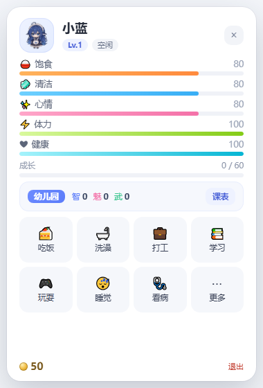
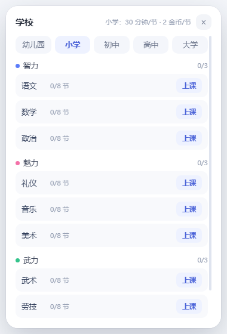

# 桌面宠物

一只住在 Windows 桌面上的小宠物：透明置顶小窗、托盘常驻、现代卡片式面板。
形象和动画借用你提供的 `dsh-pet` 素材，设定是**宠物**。

养成节奏按原版量级：**一节课 45 分钟**，每门课小学 8 节、中学 20 节、大学 40 节；
打工一班也是 45 分钟。按每天挂 4–8 小时算，读完一个大学文凭要几周，三方向全修完是几个月。






## 素材来源

| 素材 | 位置 | 来源 |
| --- | --- | --- |
| 动画（38 段 .webm，VP9 alpha） | `assets/anim/` | `dsh-pet-main\dsh-pet\assets\webm` |
| 气泡字体（上首软糖体） | `assets/fonts/candy.ttf` | `dsh-pet-main\dsh-pet\assets\fonts` |
| 头像 / 托盘图标 | `assets/avatar*.png`、`assets/tray.png` | 由待机 GIF 首帧裁切生成（`tools/make-assets.py`） |

`dsh-pet` 仓库没附 LICENSE，自己玩没问题；公开分发前请确认素材授权。

## 运行

```
%LOCALAPPDATA%\DeskPet\桌面宠物.exe      # 免安装版（已构建）
```

或双击 `启动 桌宠.cmd`；开发模式 `npm install && npm start`。
打包：`powershell -ExecutionPolicy Bypass -File .\build-portable.ps1`（默认输出到 `%LOCALAPPDATA%\DeskPet`）。

> 默认不把可执行版本放进工作区：本机实测 E: 盘启动 Electron 会被环境拦掉，C: 盘正常。

## 学校（学习）

三个方向，每个方向三门课，小学 → 中学 → 大学：

| 方向 | 课程 |
| --- | --- |
| 智力 | 语文、数学、政治 |
| 魅力 | 礼仪、音乐、美术 |
| 武力 | 武术、劳技、体育 |

| 阶段 | 每门课节数 | 每节时长 | 学费/节 | 单科耗时 | 同方向毕业耗时 | 毕业奖学金 |
| --- | --- | --- | --- | --- | --- | --- |
| 小学 | 8 | 45 分钟 | 2 金币 | 6 小时 | 18 小时 | 100 |
| 中学 | 20 | 45 分钟 | 6 金币 | 15 小时 | 45 小时 | 400 |
| 大学 | 40 | 45 分钟 | 15 金币 | 30 小时 | 90 小时 | 1500 |

- 同一方向同一阶段的**三门课全部修完**才算毕业，拿到该阶段文凭；
- 想上中学的课，得先有同方向小学文凭；大学同理；
- 每修完一门课涨该方向属性（+5 / +8 / +12），毕业发奖学金；
- 一节课结束会掉 6 点饱食和清洁，所以长课要提前喂饱。

时间感：拿到第一个**大学单科**文凭约 `18 + 45 + 30 = 93` 小时；同方向**大学全部三门**约 153 小时；
三个方向全修完约 459 小时——按每天 4–8 小时，是从几周到几个月。

## 打工

一班 45 分钟，工资按学历档位：

| 档位 | 工作 | 工资/班 |
| --- | --- | --- |
| 无学历 | 洗碗工、发传单、搬运工 | 20 / 24 / 28 |
| 小学毕业（任一方向） | 服务员、后厨帮工、快递员、收银员 | 40 / 42 / 45 / 50 |
| 中学毕业（任一方向） | 打字员、售货员、仓库管理员、保安、幼儿园助教 | 70 / 75 / 78 / 80 / 85 |
| 大学单科 | 模特(礼仪)、技工(劳技)、编辑(语文)、摄影师(美术)、教官(体育)、公务员(政治)、武术教练(武术)、指挥家(音乐)、建筑师(数学) | 105–120 |
| 大学组合 | 审判官(政治+武术) 140、主编(语文+美术) 150、宠物王(数学+美术+体育) 180 | 140–180 |

- 每班消耗 12 点饱食、12 点清洁；
- 结算时 10% 概率老板加钱（+30%），8% 概率迟到扣钱（-20%）；
- 没文凭时只能接低薪工作。

## 养成数值

- 饱食 `-10.2/小时`、清洁 `-8.4/小时`，睡觉时消耗 ×0.45（约 10 小时见底）
- 心情 `-7.2/小时`，饱食或清洁低于 20 时恶化 ×2.2
- 体力 `+90/小时`（睡觉 +360/小时，上课 +24/小时，**打工 0**），吃东西/洗澡也会立刻补体力；抛掷固定扣 10
- 成长挂机 `0.1/分钟`；上课/打工按“当前等级需求”动态结算，升一级 +20 金币
- 打工需要 **Lv.3** 以上，等级不够点「打工」会提示“我还太小了，不能打工…”
- 学习与打工互斥，进行中两个按钮都会置灰；玩耍进行中同样会置灰
- 金币：领养送 **50**；之后靠打工赚

**玩具**（点「玩耍」弹层里选，带对应动画）：

| 玩具 | 花费 | 心情 | 时长 |
| --- | --- | --- | --- |
| 挠痒痒 | 1 金币 | +12 | 4 秒 |
| 丢丢乐 | 3 金币 | +22 | 6 秒 |
| 吹气球 | 5 金币 | +24 | 7 秒 |
| 照镜子 | 6 金币 | +30 | 8 秒 |
| 踢毽子 | 6 金币 | +28 | 8 秒 |
| 玩水枪 | 8 金币 | +35 | 8 秒 |
| 下五子棋 | 8 金币 | +32 | 10 秒 |
| 撸猫 | 10 金币 | +45 | 10 秒 |
| 荡秋千 | 10 金币 | +42 | 10 秒 |
| 玩魔方 | 12 金币 | +50 | 12 秒 |

日常动作的花费与效果（面板按钮上也会显示）：

| 动作 | 花费 | 效果 |
| --- | --- | --- |
| 小饼干 | 5 金币 | +18 饱食、+2 心情、+4 体力 |
| 冰淇淋 | 8 金币 | +22 饱食、+8 心情、+6 体力 |
| 西瓜 | 10 金币 | +30 饱食、+6 心情、+8 体力 |
| 糖葫芦 | 12 金币 | +32 饱食、+8 心情、+9 体力 |
| 月饼 | 15 金币 | +35 饱食、+10 心情、+10 体力 |
| 饺子 | 18 金币 | +40 饱食、+8 心情、+12 体力 |
| 大闸蟹 | 30 金币 | +55 饱食、+12 心情、+16 体力 |
| 火锅 | 45 金币 | +75 饱食、+18 心情、+22 体力 |
| 洗澡·普通清洁 | 5 金币 | +32 清洁 |
| 洗澡·泡泡浴 | 12 金币 | +45 清洁、+12 心情、+15 体力 |
| 洗澡·汗蒸 | 18 金币 | +30 清洁、+5 心情、-10 体力、+12 健康 |
| 玩耍 | 1–10 金币 | 见下方玩具表 |
| 睡觉 | 免费 | 心情缓慢回复，消耗减半 |
| 看病 | 按病种 50–120 金币 | 治好当前病，健康 +25 |
| 复活 | 500 金币 | 复活并恢复 60/60/50 |

- 健康：饱食/清洁/心情任意一项 <25 会掉健康，三项都 >50 会慢慢回；健康低于 45 有概率生病，
  低于 20 时更容易得重病。健康归零持续 30 分钟会离开。
- 病种按诱因区分：饿 → 肠胃炎（80 金币）、脏 → 皮肤病（70）、闷 → 心情低落（50）、健康极低 → 发烧（120）。
- 饥饿+清洁归零持续 30 分钟也会离开；复活要 500 金币，钱不够可以在死亡面板里选「重新领养」。
- 退出程序即完全暂停：不结算离线时间，不涨经验也不消耗，一切保持退出时的状态；
- 退出时正在进行的打工/上课/下班倒计时会整体顺延，回来后从剩余时间继续。

### 经验 / 升级

| 来源 | 经验 |
| --- | --- |
| 挂机 | 0.1/分钟（心情 ≥90 ×1.3，心情 <40 ×0.6，睡觉 ×0.5） |
| 上课 | 每节 = 当前升级需求/6 ×（小学 1、中学 1.1、大学 1.2），修完课程再加整门成长值 |
| 打工 | 每班 = 当前升级需求/6 ×（0.6 + 0.6×工资/180） |
| 玩耍 | 每次 +3 |
| 喂食 / 洗澡 | 每次 +1 |

升级所需经验：`need(n) = 60 + 45(n-1) + 8(n-1)²`（Lv1→2 60，Lv2→3 113，Lv3→4 182…），
每升一级奖励 20 金币。
- 存档：`%APPDATA%\DeskPet\save.json`

## 操作

| 操作 | 效果 |
| --- | --- |
| 左键点它（上半身） | 摸头：心情 +5，害羞 / 手忙脚乱 |
| 左键点它（下半身） | 摸肚子：心情 +3，咯咯笑 |
| 左键拖动 | 慢慢拖：只挪位置，松手停在原地（半空也悬停）；挪动距离 < 24px 不触发抛掷 |
| 左键快速甩出 | 抛掷：松手速度 > 500px/s 就飞出去，固定消耗 10 体力、心情 +3~16；碰屏幕边缘会反弹，落地弹两下 |
| 双击它 | 打开面板 |
| 右键它（单击） | 贴着宠物弹出菜单（喂食/洗澡/去打工/去上学/玩耍/碎碎念/回到中间/睡觉/看病/免打扰/隐藏/退出），点别处或失焦自动关闭 |
| 单击托盘 | 开合面板 |
| 双击托盘 | 叫它回来 + 打开面板 |

托盘菜单只保留管理功能：打开面板、显示宠物、把宠物叫回来、免打扰（不弹气泡、不做空闲小动作）、开机自启、退出；
只有宠物死亡时才会多出「复活（500 金币）」和「重新领养」两项。
喂食/洗澡/打工/上学/玩耍这些互动放在面板和宠物右键菜单里。宠物自己散步时每次只挪 ±130px 左右，不会满屏跑。

面板底部显示当前金币；每个动作格子左上角的小金币角标就是花费。
动作顺序：吃饭 / 洗澡 / 打工 / 学习 · 玩耍 / 睡觉 / 看病 / 更多。
「看病」格和「复活」合并：平时灰着，生病了显示病种和价格、点击治疗；死亡后变成「复活」，
点击弹出选择「复活（500 金币）/ 重新领养」。病种会显示在名字旁边的红色标签里。
「更多」里是两个管理功能：
- **碎碎念管理**：列出全部自定义碎碎念，可新增/编辑/删除（最多 30 条）；有自定义时右键「碎碎念」从里面随机挑，没有就按状态说默认台词。
- **下班倒计时**：设一个每天的下班时间。剩余超过 1 小时时**每半小时提醒一次**（“呼，还有 3 个半小时才下班…”），
  最后 1 小时按 60/30/10/5/1 分钟提醒，到点说“下班啦！收工～”；同一档不重复刷屏。面板「学习」「打工」打开对应弹层：学校可按阶段/方向选课，找工作按学历筛岗位。
打工/上课时面板会显示进度条和剩余时间（`打工中 · 18:00`）；旧存档缺进度字段时会按剩余时间补一个，
打开面板就能看到。提示语都用宠物第一人称（“我正在上课”）。
上课/打工期间仍然可以摸它、喂食、洗澡、左键拖动、右键抛掷，不会打断进度；玩玩具和睡觉会打断，所以那两项在忙碌时禁用。

## 状态 → 动画

| 状态 | 动画 |
| --- | --- |
| 待机 | 待机呼吸休闲 |
| 走路 | 螃蟹走路（素材朝左，向右移动时镜像） |
| 拖拽 / 飞行 | 被鼠标拖拽悬空反馈 |
| 点击 | 点击回应-开心跃动 / 害羞惊讶 / 元气挥手 / 挠痒咯咯笑 |
| 喂食 | 按食物播对应动画（吃西瓜 / 吃糖葫芦 / 涮火锅…） |
| 洗澡 | 玩水枪 |
| 玩耍 | 按玩具播对应动画（踢毽子 / 吹气球 / 荡秋千 / 下五子棋…） |
| 打工 | 工作状态-忙碌点按 |
| 学习 | 写代码 |
| 睡觉 | 原地小憩沉眠 |
| 生病 / 离开 | 工作状态-垂头叹气冒汗 |
| 升级 | 工作状态-雀跃庆祝 |
| 复活 | 凭空生花 |
| 空闲彩蛋（每 15–30 秒一次） | 悠闲哼歌 / 超大伸懒腰 / 哈欠连天 / 照镜子 / 撸猫 / 偷吃零食被抓住 / 原地敲击桌面互动 / 深度思考碎碎念 |

## 实现要点

- **双 video 交叉淡入**：A/B 两个 `<video>` 轮流当前台，新动画 `loadeddata` 后切换 opacity。
- **朝向**：素材朝左，`facing === right` 时 `scaleX(-1)` 镜像。
- **抛掷**：松手时用最后 140ms 的指针轨迹估初速，交给 `src/physics.js` 做重力/碰壁反弹/地面摩擦，
  主进程按 60ms 步进移动窗口；体力不够时只做普通下落，不会飞出去。
- **屏幕边缘反弹**：松手时冻结「当前所在屏幕」的工作区，整段飞行只在这块屏里反弹（左右/顶/底），
  不会飞到隔壁屏。物理用固定 1/120s 子步长积分——主循环 60ms 一步的话，重力每帧灌 132px/s，
  落地反弹永远压不到静止阈值，会一直弹。注意 dsh-pet 的 `petCollision` 是**宠物之间**互撞（要多只宠物），不是撞桌面上的其它窗口。
- **长课不中断**：上课/打工都是 `busyUntil` 时间戳，主进程每秒 tick 结算；面板可以随时关掉，
  宠物在桌面上继续上课，托盘里能看到状态。
- **存档**：课程进度存「已完成节数」，旧版布尔值会自动迁移。
- **状态唯一来源**：`src/game.js` 纯逻辑，19 项单测覆盖上课/文凭/前置/工资/衰减。

## 目录

```
main.js                主进程：窗口/跟随/托盘/IPC/存档调度
src/game.js            纯逻辑：养成 + 学校 + 打工
src/store.js           JSON 存档
preload/*.js           contextBridge（pet / panel / adopt）
renderer/pet.html      透明宠物窗（双 video + 气泡）
renderer/panel.html    现代面板（含学校 / 找工作弹层）
renderer/adopt.html    领养窗口
assets/anim/           38 段 .webm 动画
tools/test-game.js     逻辑单测
tools/make-assets.py   头像/托盘图标生成
build-portable.ps1     免安装版打包
```

## 测试

```
node tools/test-game.js     # 27 项：课时/文凭/工资/衰减 + 抛掷物理 + 体力/抚摸分区
electron . --smoke          # 截图 + 走动 + 状态映射 + 学校/工作弹层
electron . --ui-test        # 注入 pointer 事件：抚摸/拖动/面板按钮/选课
```

## 已知限制

- E: 盘无法运行 Electron（本机环境限制），可执行版本放在 `%LOCALAPPDATA%`。
- 动画素材 11.8MB，免安装版约 250MB（Electron 本体占大头）。
- 多显示器按它中心所在屏幕的 workArea 算地面。
- 没做：多只宠物、聊天/碎碎念、表情包、结婚生蛋。


## 安装包

```powershell
powershell -ExecutionPolicy Bypass -File build-installer.ps1
```

生成 `dist\DeskPet-Setup-<版本>.exe`（需要 Inno Setup 6，脚本里用 `-InnoDir` 指定路径）。

- 安装到 `%LOCALAPPDATA%\Programs\DeskPet`，**不需要管理员权限**；带开始菜单/桌面快捷方式和卸载程序；
- 存档固定在 `%APPDATA%\DeskPet\save.json`，**安装、覆盖升级、卸载都不会改它**：
  - 安装前会把 `save.json` 备份成 `save.json.bak`；
  - 卸载时弹窗询问「是否同时删除存档」，默认**保留**；
- 覆盖安装会先结束正在运行的实例，装完再启动即可，存档不受影响。


## 串门（宠物去朋友家）

单向串门：**A 的宠物去 B 家**，B 是接待方，IP 直连、不需要账号。

**B（接待方）**

- 更多 → 串门 → 开启「我的门牌」，把地址（如 `192.168.1.23:8737`）和 4 位门牌码发给 A；
- 有人送来宠物时，桌面会出现**客宠窗口**：整屏自由走动、头顶名字牌，自家宠物照常；
- 客宠可以：摸头（A 的宠物心情 +1）、喂食（花 B 的金币，5 分钟一次）、送客；
- 右键客宠有菜单，左键点一下就是摸头。

**A（宠物主人）**

- 更多 → 串门 → 填地址和门牌码 → 「送过去」；
- 宠物会离家（桌面消失），面板显示「在 X 家串门」，期间不能喂食/洗澡/打工，只能「叫回家」；
- 会收到「有人摸了摸我」「对方喂了我…」「对方让我回家啦」等提示；
- 60 分钟超时、断线或对方关掉串门，会自动回家。

**对方在 NAT 后面、你连不上他怎么办**

用反向「来取」模式（0.8.1）：

- 你（宠物主人）：串门面板 → 开启我的门牌 → 点「让对方来取」，把地址和门牌码发给他；
- 对方：串门面板 → 填你的地址和门牌码 → 点「去取」；
- 他的桌面会出现你的宠物，可以摸头/喂食/送客；你随时可以在面板或托盘「叫回家」。
- 原理：连接由**他**发起（他能连你），宠物状态由你这边提供，不再要求你连他。

**协议**

- B 端用 Node 内置 `http` 起服务（默认端口 8737，可在串门面板改），零运行时依赖；
- A 端每 2 秒 `POST /visit/state` 上报展示状态，并取回互动事件（摸头/喂食/送客）；
- 只同步名字、等级、状态、动画、朝向、气泡，不传存档和金币；
- 公网使用需要路由器端口转发，或先用 Tailscale/ZeroTier 组网再填虚拟 IP。


## 宠物大小（按等级）

- 1 级约 **100px** 高，30 级约 **250px** 高，中间线性变化，宽度等比；
- 缩放公式：`scale = (100 + 150 × (等级 - 1) / 29) / 211`（211 是 1 倍时角色可见高度）；
- 只缩放宠物本体：气泡、面板文字保持原字号可读；脚底位置固定，不会因为长大而陷进任务栏；
- 命中区（点击/拖动/穿透）跟着等级缩放，面板和右键菜单仍然贴着身体。


## 更新记录

### 0.15.3
- 活动进度条右下角新增「停止」按钮，弹窗确认后停止当前打工/上课/玩耍；
- 打工按已工作时间结算，上课不计课时，停止会清空连续队列。

### 0.15.2
- 连续次数输入框不再被每秒刷新重置为 1；编辑时暂停面板重绘，失焦后保留数值。

### 0.15.1
- 安装/升级时清理旧版残留的语言包和 dxcompiler/dxil，确保精简真正生效。

### 0.15.0
- 「更多」里显示存档路径、版本号，并支持导出/导入存档（导入后自动重启）；
- 饱食/清洁/心情低于 20 时发系统通知，可在「更多」里开关；
- 打工/上课支持连续次数（1–5，默认 1），按钮左侧可编辑；
- 安装包精简：只保留中/英语言包、去掉 dxcompiler/dxil 与原始图标素材。

### 0.14.5
- 打工/上课期间持续掉心情（−0.08/分；双高时净 −0.03/分）；
- 岗位体力消耗改为 ×1.5 后取整到个位 0/2/5（如搬砖 7→10、发传单 8→12、服务员 2→2）。

### 0.14.4
- 状态条区域加入 no-drag，修复进度条悬浮说明不显示；
- 徽章提示框再右移 10px；
- 状态栏上课信息改为「上课中，小学语文1/8」。

### 0.14.3
- 专精效果调整：勤劳 −3% 时长 / −5% 体力，学霸 +3% 经验 / −3% 上课时长，幸运 +2pp 奖金 / −5% 医疗复活；取消学霸学费减免；
- 徽章层数显示改为 Lv.1 / Lv.2；
- 悬浮说明改为浅色背景并右移 12px；
- 五条状态进度条支持悬浮查看当前每小时变化速率（如「生病中 健康 -9.0/小时」「康复中 +4.8/小时」）。

### 0.14.2
- 修复专精徽章没有悬浮效果的根本原因：面板整体是 `-webkit-app-region: drag` 拖拽区，徽章是 span 不在 no-drag 白名单里，鼠标事件被拖拽吃掉；
- 给徽章区域补上 `-webkit-app-region: no-drag`。

### 0.14.1
- 面板打开时宠物窗完全让出鼠标（不再按光标切换交互），修复面板被宠物窗盖住时徽章无法悬浮。

### 0.14.0
- 五个专精全部改用图标徽章（蜂/学士帽/茶杯/对话/四叶草），自动裁成圆形并去掉白边水印；
- 专精悬浮说明改为面板内自定义提示（修复之前不显示）；
- 去掉徽章方形阴影；
- 修复宠物窗遮挡面板导致悬浮/点击失效：忽略鼠标时不再转发 hover；
- 打开/关闭面板时重新把宠物窗提升到最上层。

### 0.13.14
- 专精悬浮说明改为面板内自定义提示框（原生 title 不显示的问题修复）；
- 去掉徽章后面残留的半透明方形阴影，只保留圆形立体描边。

### 0.13.13
- 专精徽章加立体白边+投影，悬浮时轻微上浮放大；
- 鼠标悬浮徽章显示该专精的累计效果说明。

### 0.13.12
- 学霸徽章改为 34px，并右移 6px。

### 0.13.11
- 学霸徽章缩小到 38px。

### 0.13.10
- 学霸徽章改用新图（自动裁成圆形，去掉白边和水印）。

### 0.13.9
- 学霸徽章去掉灰色椭圆底，只保留圆形图标，并放大到 44px。

### 0.13.8
- 「学霸」专精徽章图标放大到 34px。

### 0.13.7
- 熟练所需次数改为 5 / 8 / 12 / 16 / 20（挡位 1–5）；
- 修正审判官/主编/宠物王的挡位数据（之前误写进课程要求，按挡位 1 计算）；
- 「学霸」专精徽章改用 src/xb.jpeg 图片展示。

### 0.13.6
- 熟练度改为单级「是否熟练」：达到次数后该岗位工作时间 -10%；
- 次数按挡位递增：挡位 1-5 分别需要 5 / 8 / 11 / 14 / 17 班；
- 岗位列表显示「熟练度 X/N · 时长 Y 分钟」。

### 0.13.5
- 熟练度改为「缩短该岗位工作时间」：每完成 n 班（n = 岗位挡位 × 5）减 1 分钟，最多减 2 分钟；
- 熟练度不再增加工资，工资只由岗位基础价和属性决定；
- 岗位列表显示当前熟练班次、距下一档还差几班、已减分钟。

### 0.13.4
- 死亡条件改为唯一一条：生病且健康为 0 连续 **1 小时**；
- 取消「生病 + 饱食和清洁都为 0 满 30 分钟」的饿死判定。

### 0.13.3
- 「离开」检测扩展到：关闭程序超 2 小时、系统待机/休眠超 2 小时、锁屏超 2 小时、系统无操作超 2 小时；
- 触发后宠物睡觉、暂停结算；点击宠物/打开面板/托盘操作唤醒。

### 0.13.2
- 死亡时所有状态归零（饱食/清洁/心情/体力/健康），清空课程与计时；
- 死亡后除「复活」外所有动作按钮禁用，并自动弹出复活窗口；
- 复活窗口显示折后价格（幸运专精）。

### 0.13.1
- 离线超过 2 小时后启动，宠物进入「离开」状态：睡觉姿势、暂停一切消耗与计时；
- 首次点击宠物 / 打开面板 / 托盘操作即可唤醒，气泡「我回来啦！」；
- 每日任务完成自动发奖（不再需要手动领取）。

### 0.13.0
- 上课不再扣清洁度；
- 每日任务：每天随机 3 个目标（喂食/洗澡/打工/上课/玩耍/抚摸/抛掷/串门/睡觉），全部完成才能在「更多 → 每日任务」领奖（30 金币 + 心情 10 + 成长 10）；
- 随机小事件：每 30–60 分钟可能发生（捡到零钱、邻居送水果、打翻水杯等），气泡提示并小幅影响数值；
- 上课走神：上课中约 60% 概率出现「走神了…点我一下！」气泡，12 秒内点宠物可拿 +5 成长、+2 心情，错过则没有。

### 0.12.7
- 去掉活动条右侧的「还差 N 升级」，只保留「成长 X / Y」。

### 0.12.6
- 上课/打工/玩耍时，活动条下方显示「成长 X / Y」和「还差 N 升级」，不再看不到经验进度。

### 0.12.5
- 修复旧存档里「进行中的幼儿园课程」仍指向旧科目导致主进程崩溃的问题；
- 启动时把 pendingCourse 从旧科目迁移到新科目（学拼音/学数数→学数数，学儿歌→学儿歌）；
- finishCourse 增加保护：课程数据异常时安全回退，不再抛异常。

### 0.12.4
- 学校面板的「已修/总数」按该方向实际课程数显示（幼儿园每方向只有 1 门，显示 0/1）。

### 0.12.3
- 幼儿园课程改为：学数数（智力）、学儿歌（魅力）、做手工（武力），每门对应一个属性方向；
- 旧存档的「学拼音」进度自动并入「学数数」；
- 幼儿园毕业（三门都修完）才能上小学。

### 0.12.2
- 专精与每日免单移到主面板按钮下方的空白处；
- 专精以徽章显示，只显示已获得的（重复选择显示 ×N）；
- 每日免单显示「每日免单 可用 / 已用」，Lv10 前不显示；
- 成长面板只列已拥有的专精，选择弹窗不再显示未拥有的 ×0。

### 0.12.1
- 岗位列表显示加成后的实际班次时长；学校显示折后学费。

### 0.12.0
- 新增成长/专精系统：每 5 级选一次专精（五选一，可重复，永久），Lv10/20/30 各 +1 次每日免单；
- 等级被动：打工时长、状态消耗、互动效果、睡觉回体力、生病概率（各自独立封顶）；
- 工资改为「岗位基础 ×（1 + 属性加成 + 熟练度加成）」，与等级无关；属性封顶 +8%，熟练度每班 +1、封顶 10 点、每点 +0.8%；
- 每日首次消费免单（Lv10 起，不限金额，复活除外）；
- 新增成长面板、专精选择弹窗、工资拆解、每日免单标签。

### 0.11.5
- 打工/放学回来的气泡改得更口语化，不再机械报进度：
  - 「学完了语文课，我感觉自己变聪明了呢」「拿到小学·智力文凭！学校奖励我 100 金币奖学金」；
  - 打工带上具体工作与到手金币，奖金/罚款用括号补充。

### 0.11.4
- 新增打工/放学回来的气泡：`主人，我打工回来啦～…`、`主人，我放学回来啦～…`；
- 扩充互动台词：吃饭、玩具、抚摸、抛掷、睡觉/起床、治疗、还钱、升级、生病、复活、中断等都有多种随机说法。

### 0.11.3
- 从托盘打开面板时，面板改为贴着托盘图标弹出（与托盘右键菜单位置一致）；双击宠物、右键宠物、托盘菜单三种入口仍跟随宠物；
- 去掉托盘双击，只保留左键单击（开/关面板）和右键菜单；
- 取消“关闭面板后重建宠物窗”，不再闪窗。

### 0.11.2
- 修复下班时间被关机冻结逻辑拼接成「17:00+一串数字」的问题（offWorkAt 是 HH:MM 字符串，不该加毫秒）；
- 启动时自动修复已损坏的 offWorkAt（取前 5 位的 HH:MM），旧存档无需手动处理。

### 0.11.1
- 面板关闭后延迟 400ms 重建宠物窗（等价于只重启宠物窗），彻底绕开“面板盖住后合成器停更”的卡动画；
- 托盘单击/双击都走同一套关闭逻辑；双击时面板快速开关不会触发白闪（重新打开会取消重建）。

### 0.11.0
- 打工/上课的饱食消耗改为一头一尾各扣一半，中断按正常结束扣；打工体力同样一头一尾各半；
- 玩耍额外消耗 2 点清洁；
- 心情：饱食和清洁都 > 60 时 +0.05/分；任一项 < 50 时 -0.12/分，两项都 < 50 时 -0.24/分；
- 治疗：健康 +20（不足 40 补到 40，超过 80 压到 80；治疗前已 >80 则不变）；
- 复活：健康 80，饱食/清洁/心情 80，体力 100。

### 0.10.5
- 修复双击托盘/打开面板盖住宠物窗导致动画卡死：关闭 Chromium 的 Windows 原生遮挡判定（CalculateNativeWinOcclusion）与后台节流；
- 关闭面板时向宠物窗补发一次恢复，重置画面看门狗计数。

### 0.10.4
- 治疗后健康直接恢复到 90（付费和欠费一致），不再只加 25/20；
- 饱食、清洁、心情都不低于 50 且不在打工时，健康 +4.8/小时缓慢回升；打工期间不享受这条回复。

### 0.10.3
- 退出程序即完全暂停：移除离线结算（不再扣饱食/清洁/健康、不会离线生病、不会自动睡觉）；
- 退出时正在进行的打工/上课/下班倒计时整体顺延，回来后从剩余时间继续。

### 0.10.2
- 「普通清洁」的气泡台词改为「洗澡澡～好舒服」。

### 0.10.1
- 针对“动画卡住只能重启”加了主进程画面看门狗：每 4 秒对比宠物窗真实像素，连续 12 秒没变化就自动恢复；
- 恢复策略：先重载渲染页，再次卡住则整窗重建（等价于只重启宠物窗，不丢存档和状态）；
- 监听 GPU/渲染进程崩溃，自动重载或重建；恢复记录写入 `%TEMP%\qqpet-anim.log` 的 `paint-stall`。

### 0.10.0
- 兼容旧存档：已经上过一部分的课程（进度 > 0）不受新增的幼儿园前置限制，可以继续上完。

### 0.9.9
- 学历改为「无 → 幼儿园 → 小学 → 初中 → 高中 → 大学」；幼儿园三门课：学拼音、学数数、学儿歌（每门 5 节、20 分钟/节、1 金币/节），毕业才能上小学；
- 状态胶囊只显示当前活动（空闲/睡觉中/上课中/打工中/玩耍中），病名单独用右侧标签显示；
- 托盘悬浮提示：名字 · 等级 · 生病了 · 当前状态；
- 去掉「看病」格子左上角的金币角标（价格在二级菜单里）。

### 0.9.8
- 右键菜单精简为只有「宠物详情」一项（双击宠物也能打开），其余交互统一走详情面板；
- 菜单窗口从 206×462 缩到 206×104。

### 0.9.7
- 带病打工/上课健康掉得更快（-0.22/分，待机 -0.15/分，睡觉 +0.05/分且上限 80）；
- 健康掉到门槛（打工 50 / 上课 30）立即中断；
- 打工按实际时长结算工钱；上课中断不计课时（学费不退）。

### 0.9.6
- 生病时的活动限制按健康值分级：健康 > 50 可打工，> 30 可上课/玩耍，≤ 30 只能看病和睡觉（喂食/洗澡不受限）；
- 生病时睡觉回健康，但最高只到 80，不会痊愈。

### 0.9.5
- 移除「睡觉 6 小时自然痊愈」；
- 保留「生病时睡觉缓慢恢复健康（+3/小时）」。

### 0.9.4
- 修复：生病时也能点「睡觉」了（之前会被“生病了要先看病”挡住，导致自然痊愈根本走不通）。

### 0.9.3
- 生病时连续睡觉 6 小时会自然痊愈（健康 +10、心情 +5），面板病名旁显示「休养 X.Xh」进度；
- 这条和欠款机制配合，解决「第一次诊费没还上又生病」的死局。

### 0.9.2
- 看病改成二级菜单：列出四种病和各自价格，没生病/病种不对/欠款未还的项目不能点；
- 诊费 = 基础价 + 健康缺失，越拖越贵（基础价 20–45，健康缺失按 0.6 金币/点）；
- 没钱可以欠一次诊费，治病后「看病」按钮变成「还钱」，还清之前不能再治疗；
- 保留「生病时睡觉缓慢恢复健康」。

### 0.9.1
- 生病且金币不够时，点「看病」自动走免费义诊：治好病、健康 +15、心情 -10，不再出现“没钱看病只能等死”；
- 生病时睡觉会缓慢恢复健康（+3/小时），挂机睡觉也能慢慢熬过去。

### 0.9.0
- 宠物从串门回家时重载渲染页再显示，彻底解决回家后动画卡住；
- 托盘只保留一个「叫回来」入口：仅在串门时出现「叫 X 回家」，回家后自动消失（移除了重复的通用召回项）。

### 0.8.9
- 客宠被叫回家后，重新把自家宠物窗提到最上层并恢复动画，避免被残留窗口挡住；
- 打开详情面板时强制置顶，修复个别情况下双击打不开。

### 0.8.8
- 学制改为小学/初中/高中/大学四段；
- 每节课时长：小学 30 分钟、初中 40、高中 50、大学 60；
- 新增高中阶段（24 节/科，学费 10，奖学金 900），大学需要高中毕业才能报名。

### 0.8.7
- 打工班次缩短，单位时间工资不变：1-2 档 10/20/30 分钟，3-4 档 15/25/35 分钟，5 档不变（30/45/60）；
- 各工作的饱食/体力/清洁消耗按新时长等比调整，同档每小时消耗金额仍基本一致。

### 0.8.6
- 打工重做：5 个档位（不显示），同档单位时间工资一致；
- 班次 30/45/60 分钟，工资随时长；
- 每份工作饱食/体力/清洁消耗不同，按「饱食 0.3、体力 1.0、清洁 0.3 金币/点」折算后，
  同档每小时的消耗金额基本一致（T0≈30、T1≈26、T2≈22、T3≈18、T4≈14 金币/时）；
- 最低档无学历要求、消耗大收入低；学历越高档位越高。

### 0.8.5
- 访客宠物按访客等级缩放，和自家宠物一致；
- 宠物外出串门期间，本地不能再上课/打工（面板置灰 + 逻辑拦截）。

### 0.8.4
- 多级菜单：三级菜单（碎碎念/下班/串门）点 × 先回到「更多」，再点才收起；
- 串门界面压缩：开关改成小拨钮，IP 和门牌码合并到「我的门牌」一项，按钮改小。

### 0.8.3
- 右键菜单打开后位置固定，不再随宠物移动；
- 宠物从串门回来会恢复动画，详情面板状态同步刷新；
- 串门地址和门牌码会记住，不再清空；
- 成功连接过的好友会出现在串门面板，可一键填入或删除；
- 「让对方来取」需要本机同意：弹窗确认，面板也有同意/拒绝，拒绝后对方拿不到宠物。

### 0.8.2
- 图标互换：程序 exe 用宠物图标，安装包用 Electron 图标；桌面快捷方式随 exe 显示宠物图标。

### 0.8.1
- 新增「让对方来取」：对方在 NAT 后面、你连不上他时，他输入你的地址来把宠物取走；
- 串门面板新增「去取」按钮，配合「让对方来取」使用；
- 修复部分情况下「叫回家」不生效的问题（强制清零离家状态）。

### 0.8.0
- 新增串门：宠物可以去朋友家（IP 直连 + 门牌码），支持摸头、喂食、送客、叫回家、超时/断线自动回家；
- 新增「测试连接」，直接区分端口通/没开接待/网段不通；
- 宠物大小按等级 1–30 缩放（100–250px），只缩放本体，气泡文字保持可读；
- 详情面板打开后可自由拖动，不再被跟随逻辑拉回；
- 托盘新增「叫 X 回家（在串门）」和「送客」；
- 修复面板渲染异常导致界面不刷新的问题。


## 自测约定

- **逻辑单测**（`node tools/test-game.js`）：只在改动 `src/game.js` 或存档逻辑时跑；纯 UI、文案、图标、打包改动跳过。
- **UI 端到端**（`--ui-test`）：只在改动渲染/主进程交互/面板/拖拽抛掷时跑；纯数值、文案、打包改动跳过。
- **冒烟**（`--smoke`）：改动渲染或需要视觉确认时按需跑。
- **串门协议**（`node tools/test-visit.js`）：只在改动 `src/visit.js` 或串门流程时跑。
- **打包**：每次出安装包都验证安装退出码、版本号、存档 SHA256 不变。
